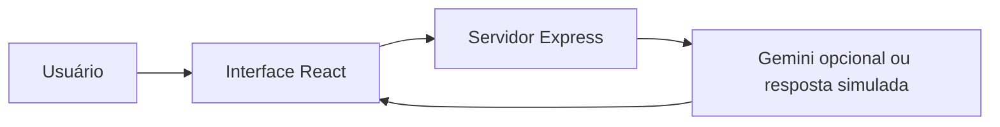

 |  | 

# Impulso Digital — Demonstração Web

## Visão geral

Aplicação web de demonstração/apresentação corporativa da Impulso Digital, com painel executivo, portfólio, ferramenta de explicabilidade de IA (XAI) e assistente conversacional. O código oferece endpoints Express para chat/análise com Gemini, mas também contém dados e respostas simulados; não é possível confirmar pelo repositório que represente um painel operacional conectado a sistemas reais.

## Objetivo e valor

**Problema/escopo:** Demonstração web da Impulso Digital com painel corporativo, ferramentas de explicabilidade de IA e assistente Gemini opcional.

**Valor verificável hoje:** o repositório torna explícitos seus artefatos, interfaces e limitações para que mantenedores e contribuidores possam avaliar o que existe sem confundir demonstração, proposta e produção.

## Arquitetura e tecnologias

Não documentada formalmente. A árvore separa interface em src/presentation/components, dados de demonstração em src/data, entidade em src/domain/entities e tipos em src/types; App.tsx compõe as telas e server.ts configura Express, endpoints e middleware/serviço estático Vite. Essa organização sugere camadas, mas não comprova uma arquitetura Clean implementada de ponta a ponta; existe um componente visual chamado CleanArchitectureViewer.

- TypeScript e TSX (GitHub identifica TypeScript como linguagem principal).
- React 19 para a interface, com Vite e plugin React.
- Node.js com Express e tsx para o servidor; esbuild no script de build.
- Bun lockfile presente (bun.lock).
- Tailwind CSS 4 via plugin Vite; Recharts para gráficos; Lucide React para ícones; Motion como dependência.
- SDK @google/genai para chamadas Gemini no servidor; GEMINI_API_KEY é lida de variável de ambiente.

## Início rápido

Os comandos abaixo refletem instruções, manifestos ou pontos de entrada presentes no repositório. Dependências externas, segredos e serviços estão indicados quando aplicável; a presença de um comando não equivale a uma execução validada.

1. Instalação sugerida: `bun install` (há bun.lock; o repositório não documenta explicitamente o procedimento de instalação).
2. `bun run dev` está declarado em package.json e invoca `tsx server.ts`; server.ts configura a porta 3000 e middleware Vite em modo não produção. Comandos declarados não foram executados na revisão estática do repositório.
3. `bun run build` está declarado: `vite build` seguido de bundle do server.ts para dist/server.cjs.
4. Após build, `bun run start` está declarado para iniciar `node dist/server.cjs`; em produção server.ts serve arquivos de dist. GEMINI_API_KEY ativa as chamadas Gemini; sem a chave, os endpoints XAI retornam respostas de simulação conforme server.ts.
5. `bun run lint` está declarado como `tsc --noEmit`; isso é verificação TypeScript, não evidência de testes automatizados. Não há script de teste declarado em package.json.
6. A árvore pública consultada não lista workflow em .github/workflows.

## Exemplo de uso

Na interface, acessar o módulo XAI, alterar controles como score de crédito ou razão dívida/renda e acionar “Gerar Análise XAI Explicável”. src/presentation/components/xai/XaiExplainerTool.tsx envia os parâmetros para POST /api/xai/analyze. Sem GEMINI_API_KEY, server.ts devolve uma resposta simulada; o componente também calcula pesos exibidos por fórmulas locais simples, não por uma implementação comprovada de SHAP/LIME. Portanto, esse exemplo demonstra a interação da interface, não análise real de crédito.

## Estado e limitações

**Maturidade indicada:** Demonstração.

- Não afirmar que dashboard, telemetria, modelos listados, logs, auditoria, autenticação ou agendamento estão conectados a serviços reais: o código observado contém dados mockados, um usuário inicial embutido e comportamentos de demonstração.
- O nome SHAP/LIME na interface não comprova implementação desses algoritmos: a interface cria pesos por fórmulas próprias e o servidor usa resposta simulada sem chave ou geração de texto Gemini com chave.
- Afirmações de conformidade ISO/IEC 42001, métricas de desempenho, precisão, equidade, status de serviços e credenciais empresariais constam em textos/dados do projeto, mas não foram validadas independentemente na revisão estática do repositório.
- .env.example descreve GEMINI_API_KEY como necessária, enquanto server.ts prevê respostas simuladas sem ela; documentar explicitamente essa diferença e não incluir segredos no repositório.

## Contribuição

Leia [CONTRIBUTING.md](CONTRIBUTING.md) antes de abrir uma issue ou pull request. Para reportes de segurança, siga a orientação específica do repositório, se houver.

## Licença

Este repositório está licenciado sob **MIT**; consulte [LICENSE](LICENSE).

## Patrocínio e apoio

O desenvolvimento aberto exige tempo para manutenção, documentação, testes, revisão de contribuições e resposta a issues. Se este projeto for útil, considere apoiar a continuidade pelo [GitHub Sponsors](https://github.com/sponsors/felipetjmg1-bit). O apoio não representa promessa de funcionalidades, prazo de entrega ou suporte comercial.

